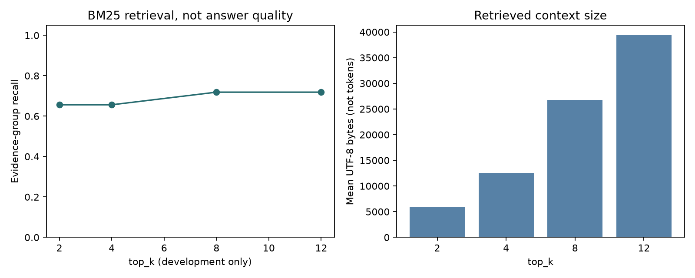
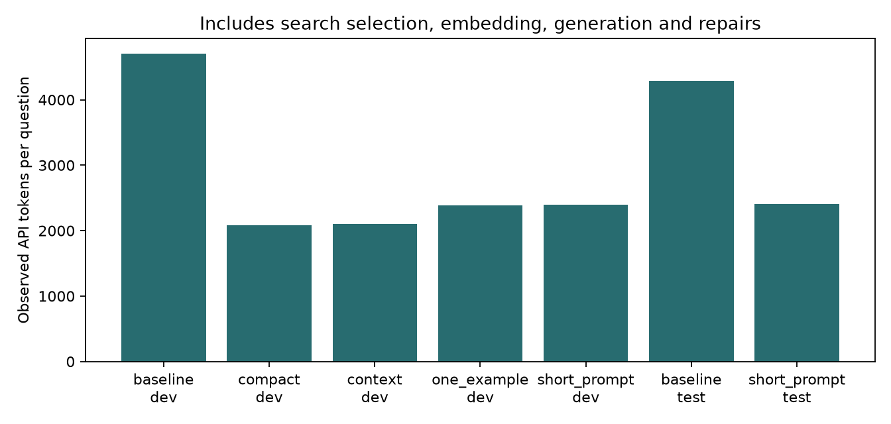
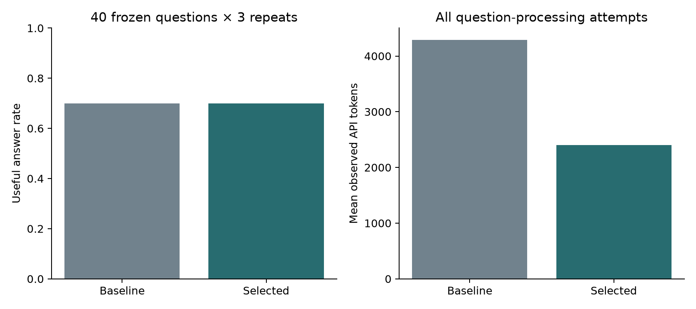

# Итоговый проект: RAG по стенограммам ПМЭФ

Автор проекта — Иван Лазичный.

Дата проверки: 20 октября 2026 года. Источники: материалы восьми занятий и предоставленный индекс ПМЭФ.

## Реализовано

Python-пакет, CLI и демонстрационный ноутбук. Корпус: 30 стенограмм 2011–2016 годов, 1952 фрагмента, EmbeddingsGigaR, 2560 координат. Два поисковых инструмента — семантический cosine search и BM25 — доступны через нативный function calling GigaChat. Ответ валидируется по фиксированной JSON-схеме, идентификаторам и дословным цитатам. Предусмотрены ограниченные ReAct и self-consistency, точный кеш, журнал всех попыток и воспроизводимый оценочный контур.

## Что фактически проверено

Офлайн-тесты проверяют OAuth-контракт, протокол функций, state ID, эмбеддинги, ошибки, лимиты, обе функции поиска, цитаты, кеш, оценку и экономические метрики. Mock-тесты не доказывают доступность живого API.

Живой preflight: модель `GigaChat-2-Max`, scope `GIGACHAT_API_B2B`, native function calling и продолжение истории подтверждены; JSON Schema подтверждена; размерность embedding 2560. Записанный расход preflight: 302 токенов.

Последний локальный прогон: **51 тестов**, ошибок 0, провалов 0. Журнал — tests.xml.

## Золотой набор и границы выводов

60 вопросов: 20 dev и 40 test. Разделение по исходной стенограмме, группы между split не пересекаются. Присутствуют факты, перечисления, составные вопросы, отказы и инъекции. У каждого обязательного факта есть проверенный текстовый фрагмент и альтернативные chunk_id с тем же свидетельством. Для калибровки подготовлены 20 примеров. Содержательные метрики рассчитаны автоматическим оценщиком. Набор преимущественно проверяет факты из вводных частей 15 стенограмм и не представляет весь спектр вопросов по ПМЭФ.

## Локальная проверка поиска

BM25 проверен без LLM. Год выделяется фиксированным выражением из вопроса, без эталонных метаданных. Это отдельная диагностика retrieval: её нельзя интерпретировать как качество ответов GigaChat или реальное сокращение токенов.

| top_k | Dev recall по группам свидетельств | Dev MRR | Средний объём текста, UTF-8 байт |
|---:|---:|---:|---:|
| 2 | 0.656 | 0.625 | 5901 |
| 4 | 0.656 | 0.625 | 12594 |
| 8 | 0.719 | 0.637 | 26760 |
| 12 | 0.719 | 0.637 | 39348 |

Выбранный на dev top_k: **8**. На test: recall **0.784**, MRR **0.670**. Вопросы без ответа исключены из recall. Размер текста в байтах не является числом токенов.

## Живое сравнение вариантов

| Вариант | Split | Вопросов × повторов | Полезные ответы | Покрытие оценкой | Средние токены | ₽ / полезный ответ |
|---|---|---:|---:|---:|---:|---:|
| baseline | dev | 20 | 0.700 | 1.000 | 4701 | 4.365 |
| compact | dev | 20 | 0.600 | 1.000 | 2078 | 2.252 |
| context | dev | 20 | 0.650 | 1.000 | 2103 | 2.103 |
| one_example | dev | 20 | 0.650 | 1.000 | 2388 | 2.388 |
| short_prompt | dev | 20 | 0.700 | 1.000 | 2398 | 2.227 |
| baseline | test | 120 | 0.700 | 1.000 | 4288 | 3.982 |
| short_prompt | test | 120 | 0.700 | 1.000 | 2404 | 2.232 |

Принятие оптимизации на фиксированном тесте: **True**. Регрессий в парах вопрос–повтор: 12; улучшений: 12. Сокращение токенов: 0.439. Подробности каждого случая — в comparison.json.

95% bootstrap-интервал разности долей полезных ответов: [-0.1, 0.1002083333333322]. Повторные генерации одного вопроса остаются одной группой. Вывод ограничен этим набором; принятие по точечной оценке не доказывает отсутствие регрессий во всех будущих вопросах.

У baseline есть попытки без usage после транспортных ошибок: его расход и стоимость — нижняя граница. У выбранного варианта все usage известны. Его полная стоимость ниже даже нижней границы baseline, поэтому экономия подтверждается консервативно; процент снижения посчитан по известному usage. При неизвестном расходе выбранного варианта автоматическое принятие запрещено.

## Дополнительные техники на фиксированном dev-срезе

| Вариант | Вопросов | Полезные ответы | Средние токены | ₽ / полезный ответ |
|---|---:|---:|---:|---:|
| extra_control | 6 | 0.500 | 2219 | 2.885 |
| multihop_control | 4 | 0.250 | 2996 | 7.790 |
| multihop_react | 4 | 0.250 | 11094 | 28.789 |
| react | 6 | 1.000 | 7875 | 5.110 |
| self_consistency | 6 | 0.333 | 6130 | 11.953 |

Ошибки `extra_control`: {'no_valid_candidate': 1}. Их токены включены в расход.

Ошибки `multihop_control`: {'no_valid_candidate': 1}. Их токены включены в расход.

Ошибки `multihop_react`: {'no_valid_candidate': 1}. Их токены включены в расход.

Ошибки `self_consistency`: {'no_valid_candidate': 1, 'self_consistency_no_consensus': 1}. Их токены включены в расход.

Этот срез состоит из заранее отмеченных составных dev-вопросов. Он не используется для настройки после test. Дорогая техника не включается в основной вариант только потому, что она сложнее; ошибки согласования и лишние шаги учитываются в расходах.

Self-consistency сопоставляет явные нормализованные факты. Различные выделенные значения или названия отношений могут не дать кворума даже при близких по смыслу ответах; отсутствие консенсуса считается провалом. ReAct может улучшать полноту за счёт повторного поиска, увеличивая стоимость и задержку. Шесть вопросов и один повтор не доказывают устойчивое преимущество на других задачах.

Варианты multihop_control/multihop_react используют отдельные четыре dev-вопроса: для каждого проверено отсутствие одного фрагмента, содержащего все обязательные свидетельства. Этот дополнительный срез не меняет основной золотой набор 20/40 и зафиксированную конфигурацию.

## Живая проверка двух инструментов

- `semantic_search`: selector `forced`, ответ `ok`, ошибка `None`, наблюдаемые токены 2207.

- `keyword_search`: selector `forced`, ответ `ok`, ошибка `None`, наблюдаемые токены 2005.

Это принудительные нативные вызовы для проверки протокола. В основных автоматических прогонах модель преимущественно выбирала BM25; эти две демонстрации не доказывают качество самостоятельного выбора семантического поиска.

## Точный кеш отдельно от основного сравнения

| Вопрос | Попадание | Наблюдаемые API-токены |
|---|---|---:|
| Кто модерировал IT-завтрак ПМЭФ-2016? | False | 5163 |
| Кто модерировал IT-завтрак ПМЭФ-2016? | True | 0 |
| Кто модерировал IT-завтрак ПМЭФ-2014? | False | 1978 |

## Проверка воспроизведения индекса

Повторно векторизованы 2 фрагмента; идентификаторы совпали, размерность 2560, cosine с предоставленными векторами [0.9999203681945801, 0.9999285340309143]. Новый расход — 644 embedding-токена. Полный корпус повторно не векторизовывался.

## Учёт расходов

Основной расход вопроса включает выбор функции, embedding запроса, генерацию и исправления. Токены судьи, preflight и индексации учитываются отдельно. При транспортной ошибке расход попытки может быть неизвестен; он помечается как неизвестный и не подменяется подтверждённым нулём. Исторические 845339 embedding-токенов из учебного index_stats не являются нашим запуском.

В REST v1 GigaChat precached_prompt_tokens показываются отдельно, а prompt_tokens/total_tokens уже отражают расход после серверного кеша. Повторно вычитать precached нельзя. Даже при выключенном кеше готовых ответов серверное кеширование префикса может влиять на наблюдаемые цифры; поэтому сохраняются оба поля, а сокращение API-токенов не приписывается целиком одному изменению текста.

Профиль configs/tariff.json хранит пакетный эквивалент: 0,65 ₽/1000 токенов GigaChat-2-Max и 0,014 ₽/1000 embedding-токенов, проверенный по официальной странице для юрлиц 20.10.2026, scope GIGACHAT_API_B2B. Это расчётный эквивалент по пакету; фактическое списание денег и индивидуальные условия договора не подтверждены. При другой модели или scope денежная оценка отключается до выбора соответствующего тарифа.

Источник тарифа: [официальная страница](https://developers.sber.ru/docs/ru/gigachat/tariffs/legal-tariffs).

Стоимость полезного ответа = расходы обработки всех вопросов / число ответов, прошедших формат, факты и groundedness. Если содержательная оценка неполна или полезных ответов нет, показатель остаётся неопределённым.

## Как воспроизвести результаты

Выполнить `python scripts/run_experiments.py` после успешного preflight. Скрипт калибрует судью, прогоняет последовательные варианты на dev, выбирает конфигурацию до просмотра test, затем выполняет baseline и выбранный вариант на 40 test-вопросах по три раза. Self-consistency и ReAct оцениваются отдельно на заранее отмеченных составных dev-вопросах. При неполной оценке выбор варианта останавливается, сохраняя журналы для ручной проверки.

Человеческие правки принимаются через `scripts/human_review.py`: примеры судьи можно экспортировать, разметить и импортировать до калибровки при последующих изменениях.

## Разбор ухудшений

Разобраны все 12 парных регрессий по 8 вопросам. Наблюдаемые типы: `validation_opaque` — 7, `incorrect_fact_with_valid_quotes` — 1, `false_refusal` — 3, `unsupported_relation` — 1. У старых no_valid_candidate отсутствует конкретная причина проверки и текст отклонённого кандидата: причина не восстанавливается предположением. [Разбор каждой попытки](error_analysis.md) и [ответы с идентификаторами запусков](error_analysis.json) сохранены отдельно.

## Соответствие шести критериям задания

| Критерий | Реализация и фактическое доказательство | Ограничения |
|---|---|---|
| 1. Сквозной RAG на GigaChat | corpus/search/pipeline, prepare/build-index; предоставленный индекс на 1952 фрагментах, живой preflight и сквозные ответы в reports/runs | В общей проверке повторно векторизованы два фрагмента, не весь корпус; используются предоставленные фрагменты |
| 2. Минимум два поисковых инструмента через function calling | Автоматические native-вызовы: semantic_search: 4, keyword_search: 362; успешные forced-демонстрации: semantic_search: 1, keyword_search: 1. Источник: live_tool_coverage.json и исходные JSONL. | Самостоятельный выбор модели преимущественно BM25; частота выбора не равна качеству поиска |
| 3. Фиксированный структурированный ответ | JSON Schema, Answer и validate_grounding; живой schema-probe и проверки формата в каждой оценке | Невалидный кандидат не выдаётся за ответ; операционные ошибки отдельно. Дословная цитата не гарантирует смысловую поддержку |
| 4. Количественно обоснованная оптимизация | На 120 парах полезность 70.0% → 70.0%; известные API-токены −43.9%; ₽/полезный ответ 3.982 → 2.232. Baseline содержит неизвестный usage; его стоимость — нижняя граница. Вывод ограничен фиксированным набором и автоматическим оценщиком. | Равная точечная полезность не доказывает статистическую неухудшаемость; интервал и парные регрессии приведены выше |
| 5. Gold, воспроизводимый замер, стоимость и отчёт | 20 dev + 40 test, baseline и выбранный вариант по три повтора; usage, судья и индексация раздельно; JSONL, comparison.json, reproducibility.json и этот отчёт | 15 из 30 стенограмм, преимущественно вводные факты; метрики автоматические |
| 6. Дополнительные эксперименты после baseline | Живые журналы extra_*.jsonl и сравнительные таблицы выше: self-consistency, ReAct, отдельный настоящий multihop-срез; точный кеш измерен отдельно. Неудачные варианты и расходы сохранены. | Малые dev-срезы; преимущество агента на простых вопросах не переносится на все многошаговые задачи |

Подготовлены две видеозаписи до 10 минут. Озвучка синтезирована. [Чек-лист сдачи](../docs/submission_checklist.md) фиксирует выполненные требования и отдельно описывает организационную передачу в учебный каталог.

## Расходы по сохранённым журналам

| Этап | Известные API-токены | Пакетный эквивалент, ₽ | Попытки с неизвестным usage |
|---|---:|---:|---:|
| Основные вопросы dev | 273361 | 177.6847 | 1 |
| Основные вопросы test | 803042 | 521.9773 | 3 |
| Дополнительные техники | 153707 | 99.7995 | 0 |
| Судья (оценка ответов) | 409549 | 266.2068 | 1 |
| Судья (калибровка) | 14523 | 9.4399 | 0 |
| Индексация (2 фрагмента) | 644 | 0.0090 | 0 |
| Настройка dense retrieval | 1099 | 0.0154 | 0 |
| Preflight | 302 | 0.1963 | 1 |
| Демонстрации инструментов и ответов | 7402 | 4.7852 | 0 |
| Кеш-эксперимент | 7141 | 4.6417 | 0 |

Таблица охватывает сохранённые журналы. Она не является банковским счётом; отдельные ручные диагностические запросы без журнала в неё не включены. Неизвестный usage не заменён измеренным нулём. Повторно использованные токены префикса записаны отдельно.
